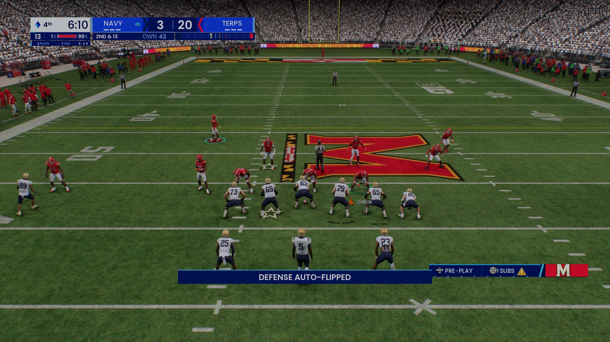
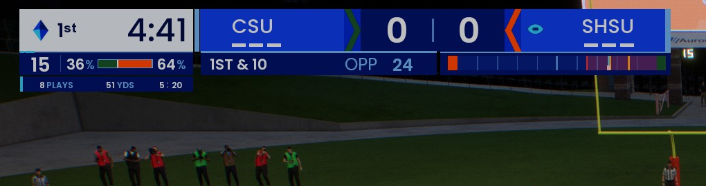
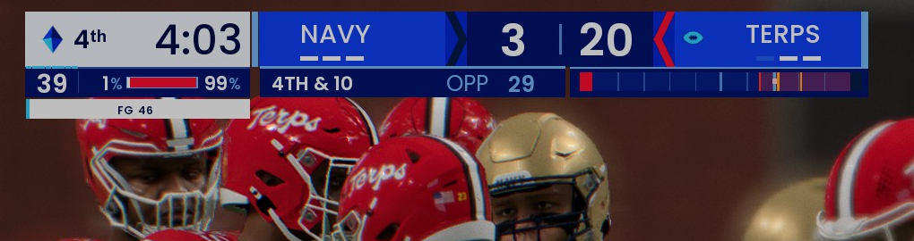
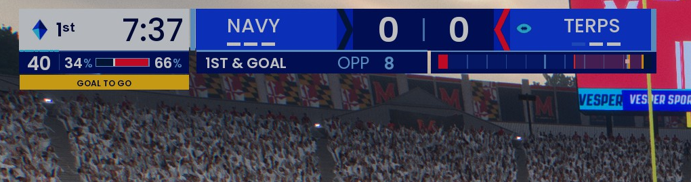
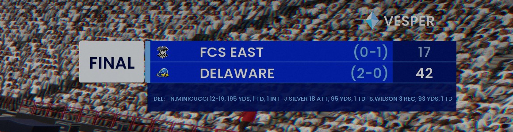
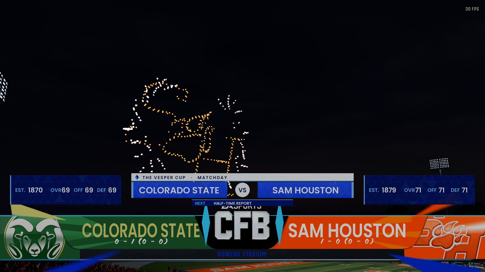
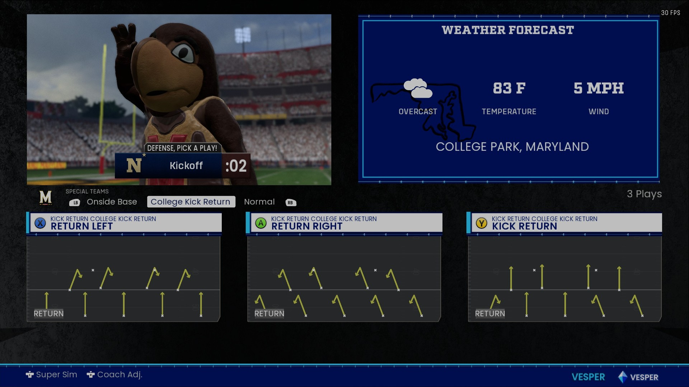
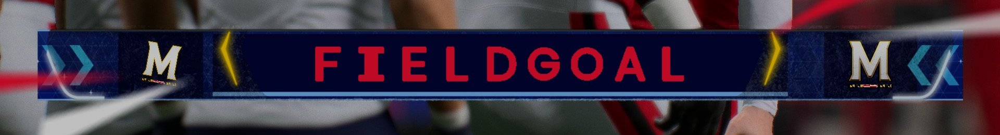
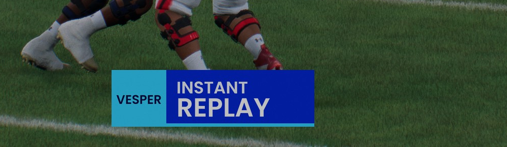
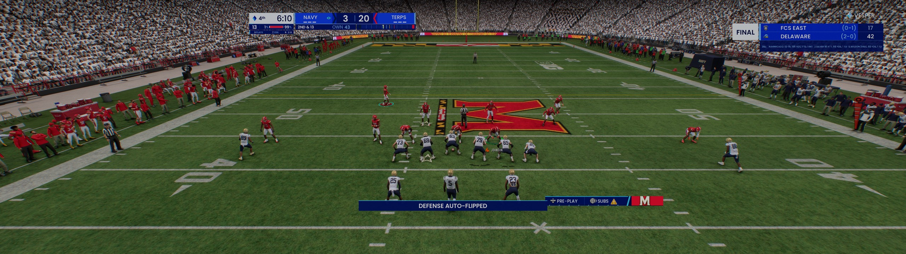

# Studio Vesper

**A night-match TV presentation for College Football 27: THE VESPER CUP on VESPER SPORTS.**

One `.fbmod` restyles the whole broadcast in night navy, royal blue and cyan: the score bug, the other-game scores,
the pregame screen, the loading screen, the play-call screen, the field goal and replay graphics, and the fonts. It
also adds live game info the stock bug doesn't show: win probability, the current drive, field goal range and
situation alerts.

## What's in it

- **Score bug:** a compact bug at the top left. It has a white clock chip, a royal team bar with chevron team tabs,
  down and distance, and a mini field strip showing the ball and the yellow line to gain.
- **Win probability:** a live win % bar under the clock that moves with the score and the time left.
- **Drive chip:** plays, yards and time of the current drive, e.g. `8 PLAYS 51 YDS 5:20`.
- **Field goal range:** a red line on the field strip at the opponent's 35, and a red zone once the ball is inside it.
- **Situation alerts:** chips for GOAL TO GO, RED ZONE, 4TH DOWN and the two-minute warning. On a 4th down in range,
  the chip shows the kick distance (`FG 46`).
- **Timeouts:** after a timeout, the bug shows how many that team has left.
- **Corner scores:** other games in a box at the top right, with logos, records, a dot for the team with the ball,
  stat lines and FINAL / UPSET ALERT / STUDIO UPDATE tags (dynasty games).
- **Pregame:** a VESPER CUP matchup row with a fact card per team (founding year, overall, offense and defense
  ratings).
- **Loading screen:** an animated Vesper Cup intro and loop.
- **Play-call screen:** navy and cyan cards, panels and play art, and a restyled weather card.
- **Field goals and replays:** a FIELDGOAL banner in the kicking team's colours, and a VESPER INSTANT REPLAY wipe.
- **Late drives:** the game's yellow on-field field goal line shows on close late drives (tied or down 1 to 3 in the
  last 2 minutes of the half or the last 3 minutes of the game).
- **Ultrawide:** the bug sits at the corner of the 16:9 picture rather than the far edge of the monitor.

| | |
|---|---|
|  |  |
|  |  |

| | |
|---|---|
|  |  |
|  |  |

## Pick one file

| File | Top right |
|---|---|
| `StudioVesper.fbmod` | VESPER logo + corner scores box |
| `StudioVesper-NoScores.fbmod` | VESPER logo only, no other-game scores |

Enable only one of them.

## Install

1. In the Mod Manager, import `StudioVesper.fbmod` or `StudioVesper-NoScores.fbmod`.
2. Turn off any other score bug or broadcast package (NBC, ESPN, CFP ESPN, CFB on CN and similar), and any Hide
   Scorebug mod. They replace the same screens.
3. Apply and launch.

## Notes

- Very dark navy team colours can be hard to read on the FIELDGOAL banner.
- A penalty that moves the ball before a snap can count as a play on the drive chip.
